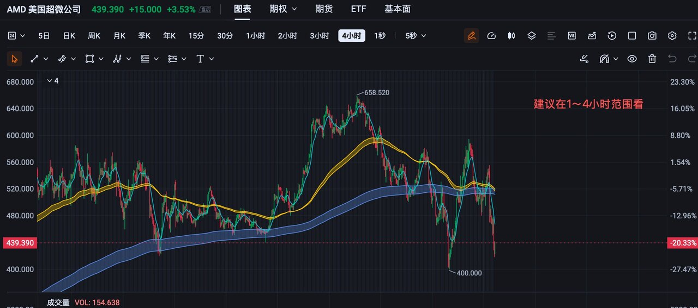
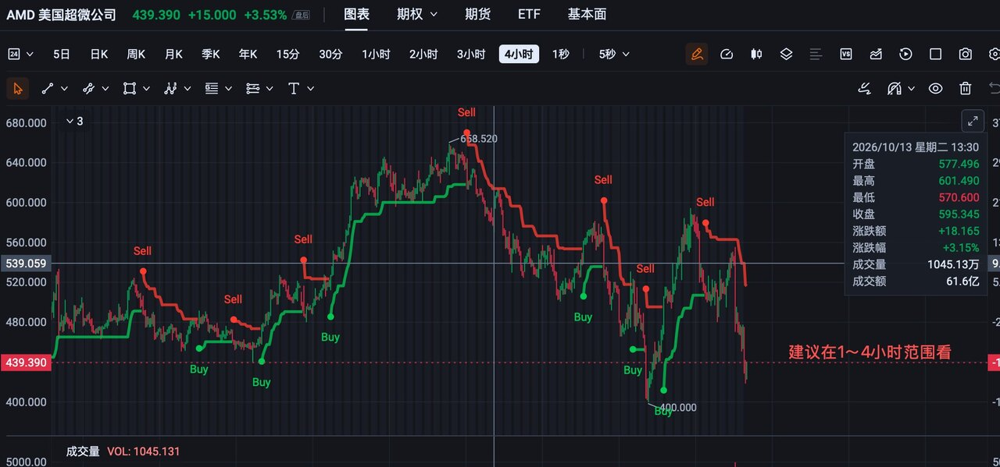
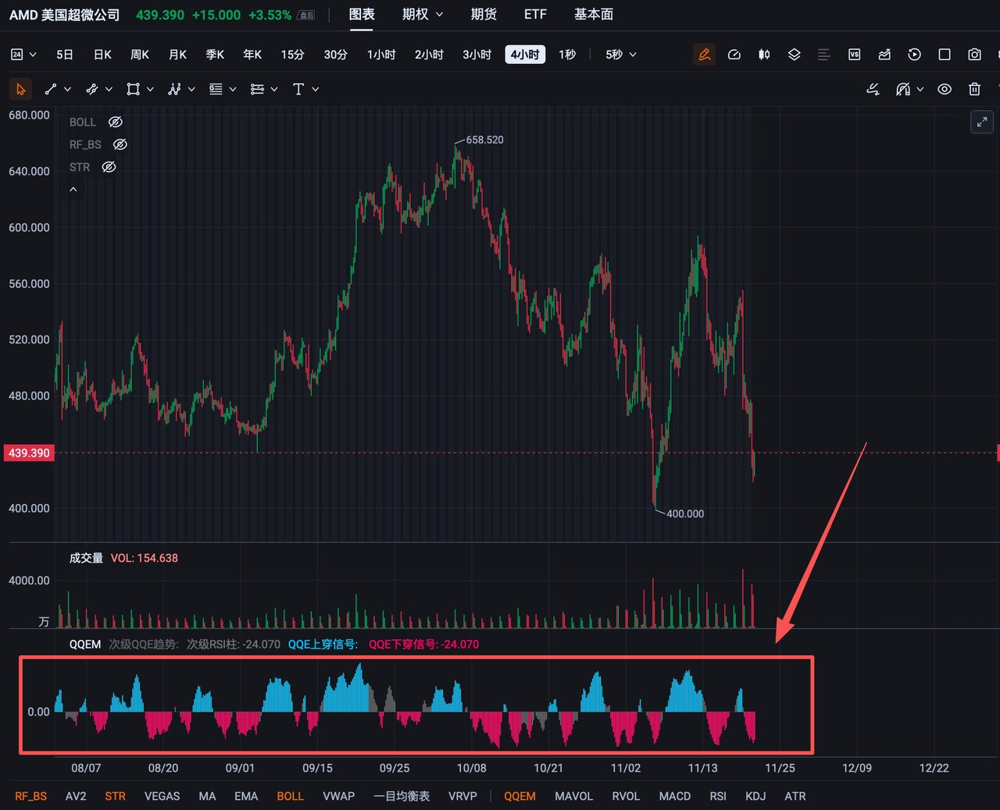
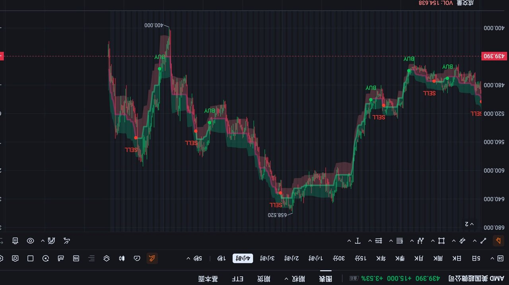
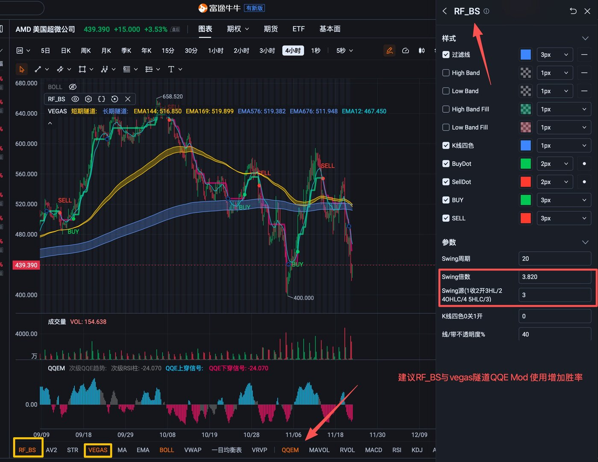

# 富途牛牛自编指标合集 · Futu / moomoo Custom Indicators


-blue)


一套跑在**富途牛牛 / moomoo 客户端「自编指标」Python 模式**下的趋势指标，把 TradingView 上常用的几个 Pine 脚本逐个翻译成富途沙箱能跑的代码。

包含：

| 缩写 | 名称 | 来源 / 对照 | 位置 | 类型 |
| --- | --- | --- | --- | --- |
| `STR` | **SuperTrend 超级趋势** | 对齐富途官方 `SUPER_TREND`，加双色分段 + Buy/Sell 换向标记 | [`indicators/SuperTrend/str.py`](indicators/SuperTrend/str.py) | 主图 |
| `QQEM` | **QQE MOD** | Pine v6 QQE MOD 移植（双 QQE + RSI 柱 + 布林带信号） | [`indicators/QQEM/qqem.py`](indicators/QQEM/qqem.py) | 副图 |
| `VEGAS` | **Vegas 隧道** | EMA12 + EMA144/169 快隧道 + EMA576/676 慢隧道 | [`indicators/Vegas/vegas.py`](indicators/Vegas/vegas.py) | 主图 |
| `RF_BS` | **VuManChu Swing Free**（Range Filter B&S） | VuManChu "Range Filter - B&S Signals" 移植，过滤线 + 上下轨色带 + BUY/SELL | [`indicators/RF_BS/rf_bs.py`](indicators/RF_BS/rf_bs.py) | 主图 |
| `AV2` | **Trend Indicator A v2.3**（附加） | DZIV 的 Pine v5 原版翻译，Heikin-Ashi 均线趋势带 | [`indicators/AV2/av2.py`](indicators/AV2/av2.py) | 主图 |

> 每个目录里同时放了 `.py` 源码和可以直接「导入」的 `.ftindex` 指标文件。

---

## 效果预览

**SuperTrend + Vegas 隧道（4 小时，AMD）** —— 绿线在价格下方（多头）/ 红线在上方（空头），金色快隧道 + 蓝色慢隧道叠加在同一张主图上：



**SuperTrend 换向信号（4 小时）** —— 每次方向翻转在轨道拐点处打 `Buy` / `Sell` 圆点 + 文字，换向竖线用背景色涂掉，视觉上就是断开的阶梯线：



**QQE MOD（4 小时副图）** —— 上：次 QQE 趋势线（白）；中：次级 RSI 柱（超过阈值才出柱，青 = 上穿信号、品红 = 下穿信号）；参数在指标面板里可调：



**VuManChu Swing Free / RF_BS（4 小时）** —— 阶梯状过滤线 + 上下轨色带，过滤线上下穿出即标 BUY / SELL：



**RF_BS 参数面板** —— `Swing周期` / `Swing倍数` / `Swing源` / `K线四色` / `不透明度` 都可以在右侧面板里改：



> 截图都在富途牛牛客户端上、**4 小时 / 1~4 小时**周期截的。这类趋势指标在分钟级别噪音太大，建议至少放在 1 小时以上看。

---

## 安装

### 方式一：直接导入 `.ftindex`

1. 富途牛牛 → 右键图表 → **指标管理**
2. 左上角 **导入** → 选择对应目录下的 `.ftindex` 文件（如 `indicators/SuperTrend/STR.ftindex`）
3. 在主图/副图上勾选即可

### 方式二：新建 Python 指标

1. **指标管理 → 新建指标**
2. 脚本语言选 **Python**
3. 把对应 `.py` 文件全文粘贴进去，保存
4. 主图指标缩写不要和已有的撞名，撞了会报「指标缩写冲突」

---

## 各指标说明

### SuperTrend（`STR`）— 主图

ATR 加权的棘轮止损线：多头段止损只抬不落、空头段只压不升，收盘越线即翻向。

- `tr   = max(high-low, |high-prev_close|, |low-prev_close|)`
- `atr  = Wilder 平滑（RMA）`，与 TradingView `ta.atr` 同源
- `upper = src + mult * atr`，`lower = src - mult * atr`
- 空头时 `st = min(upper, 上一根 st)`，收盘升破 `st` 翻多；多头对称，`st = max(lower, 上一根 st)`

| 参数 | 默认 | 说明 |
| --- | --- | --- |
| ATR长度 | 9 | Wilder 平滑周期 |
| ATR系数 | 4.8 | 倍数越大轨道越远、越少翻向 |
| 线透明度% | 23 | 线的不透明度 = 100 - 该值 |
| 轨道源(1收2开3HL/2 4OHLC/4 5HLC/3) | 3 | 轨道基准价，3 = hl2（官方默认） |

要点：
- **一条线逐根上色**，不要拆成两条用 `nan` 断开的线 —— 富途 plot 会跨 `nan` 段连线，会拉出乱七八糟的长斜线。
- 富途自带 `tr().sma(n)` 算出来的 ATR 量级偏小，轨道会贴着 K 线，所以这里自己算 TR + RMA。
- `plot_text / plot_icon` 的偏移是**像素**，不跟价格缩放，标记间距恒定。

### QQE MOD（`QQEM`）— 副图

两组 QQE（主 6 / 平滑 5 / 因子 3.0，次 6 / 5 / 1.61），各自 RSI → EMA 平滑 → 用 `|Δ平滑RSI|` 的 EMA 乘因子得动态 ATR，再由 smoothedRSI ± 动态ATR 维护棘轮带上/下沿；主趋势线 − 50 做 SMA50 ± 0.35σ 布林带，副 RSI − 50 画柱。

| 参数 | 默认 |
| --- | --- |
| 主RSI长度 / 主RSI平滑 / 主QQE因子 / 主阈值 | 6 / 5 / 3.0 / 3.0 |
| 次RSI长度 / 次RSI平滑 / 次QQE因子 / 次阈值 | 6 / 5 / 1.61 / 3.0 |
| 布林长度 / 布林倍数 | 50 / 0.35 |

- 上穿信号（青）：次 RSI − 50 > 阈值 **且** 主 RSI − 50 > 布林上轨
- 下穿信号（品红）：对称条件

### Vegas 隧道（`VEGAS`）— 主图

- EMA12（青）作短期动能线
- **快隧道** EMA144 / EMA169（金）
- **慢隧道** EMA576 / EMA676（蓝）

隧道区域填 30% 透明底色；两隧道重叠区有现成注释掉的 `plot_fillcolor("隧道重叠", ...)`，需要的话解注释即可。价格回到慢隧道附近通常对应大级别趋势的关键支撑/压力。

### VuManChu Swing Free（`RF_BS`）— 主图

原始出处是 TradingView 上 VuManChu 的 *Range Filter - B&S Signals*。

- `diff = |src - src[1]|` → EMA(n) → EMA(2n-1) → `rng = ema2 * qty`
- 过滤线棘轮：`filter = x - rng > 上一过滤线 ? x - rng : 上一过滤线`（空头对称）
- 方向由过滤线本身的升降决定；**方向向上且收盘在过滤线上方 → BUY**，方向向下且收盘在过滤线下方 → SELL
- 上下轨 = 过滤线 ± rng，填半透明色带

| 参数 | 默认 | 说明 |
| --- | --- | --- |
| Swing周期 | 20 | 平滑长度 |
| Swing倍数 | 3.820 | 轨宽倍数 |
| Swing源(1收2开3HL/2 4OHLC/4 5HLC/3) | 3 | 计算基准价 |
| K线四色0关1开 | 0 | 用过滤线方向给 K 身重新上色 |
| 线/带不透明度% | 40 | |

### AV2 · Trend Indicator A v2.3（`AV2`）— 主图

附加项。按 DZIV 的 Pine v5 原版（CC BY-NC-SA 4.0）翻译：

1. OHLC 先转 Heikin-Ashi（递归 `ha_open = (前ha_open + 前ha_close)/2`，`ha_close = (o+h+l+c)/4`）
2. HA 的 o/c/h/l 各做一次同类型均线（1 EMA、2 SMA、3 WMA、4 ZLEMA、5 HMA、6 ALMA、7 VWMA、8 SWMA）
3. `trend = 100 × (ma_close − ma_open) / (ma_high − ma_low)`，多头上色绿、空头红
4. 主图画 `ma_close` 线，o/c 之间填云带（alpha 透明，避免盖住 K 线）

参数：`MA类型`、`MA周期`、`显示高低线`、`显示云带`、`线透明度%`、`曲线平滑(0关)`。

---

## 组合用法

截图里用的组合（也是这些指标作者推荐的）：

```
主图：STR（SuperTrend）+ VEGAS（隧道）   ← 趋势方向 + 大级别支撑压力
主图：RF_BS（VuManChu Swing Free）        ← 过滤线以下的 BUY 是顺势入场
副图：QQEM（QQE MOD）                    ← 青柱上穿 = 动能确认
```

三者共振（SuperTrend 转多 + RF_BS 刚出 BUY + QQE 青柱放大）的信号质量明显高于单一指标。

---

## 富途 Python 指标引擎的坑（改代码前必读）

富途的 Python 指标跑在 **pocketpy 沙箱**里，没有 numpy / pandas，只有内置 API（`close()` / `ema()` / `iff()` / `plot_fillcolor()` …）。以下是踩过的坑：

1. **`input_parameter` 只能放模块顶层**。放进函数 / `try` 块都会报错。
2. **`plot` / `plot_text` / `plot_icon` / `plot_fillcolor` 不能出现在局部作用域**，包括 `try` 块和模块顶层的 `if` 块 —— 富途把顶层 `if` 也当局部作用域。要「关掉」某条绘图，就把 `cond` 置成恒 `False`（如 `_body_top > 1e18`），而不是用 `if` 包起来。
3. **不支持**：推导式、`lambda`、三元表达式、`**`、相邻字符串隐式拼接。
4. **序列对象**：`s = close() * 0.0` 造一个平台序列，再逐根 `s[i] = v` 赋值。`plot_fillcolor` 的 val1 / val2 必须是这种平台序列，直接传普通 `list` 会报「期望 Sequence[int,float,nan]/int/float，得到 'list'」。
5. **`plot` 会跨 `nan` 连线**：想让线断开就要另想办法（涂背景色 / `Color(r,g,b,0)`），不能靠 `nan`。
6. **`Color(r, g, b, a)`** 第 4 位是 alpha；`Color.hex("#RRGGBB")` 不透明。
7. **`output_parameter` 只收序列**，不收标量。
8. 内核 `globals()` 是 `namedict`，没有 `.get` 方法，取数只能直接调 `close()` / `high()` 等。
9. **指标缩写别撞名**，撞了报「指标缩写冲突」。
10. 富途会沿用**同名参数的存档值**，改默认值对已存在的指标不生效 —— 改默认值时顺手换个新参数名。

---

## 目录结构

```
.
├── indicators/
│   ├── SuperTrend/   str.py   STR.ftindex
│   ├── QQEM/         qqem.py  QQEM.ftindex
│   ├── Vegas/        vegas.py VEGAS.ftindex
│   ├── RF_BS/        rf_bs.py RF_BS.ftindex
│   └── AV2/          av2.py   AV2.ftindex
└── docs/
    └── screenshots/  截图
```

---

## 免责声明

仅为技术指标代码的整理与移植，**不构成任何投资建议**。指标只是对历史价量的统计，不预测未来；请在实盘前自行回测与验证。

---

## License

MIT（`AV2` 部分源翻译自 DZIV 的 Pine v5 脚本，原脚本为 **CC BY-NC-SA 4.0**，沿用其非商业 / 相同方式共享条款）。
